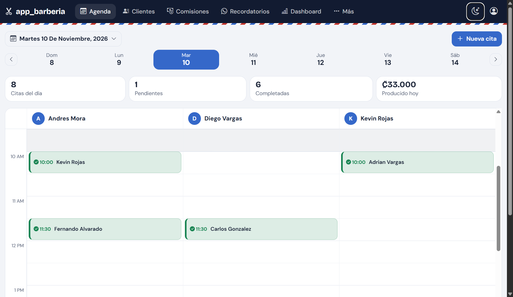
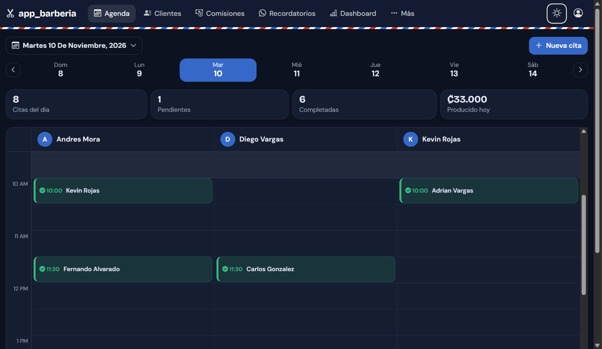
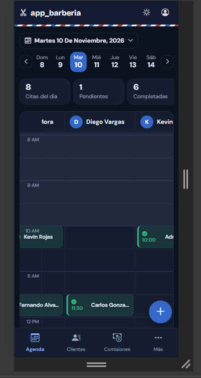
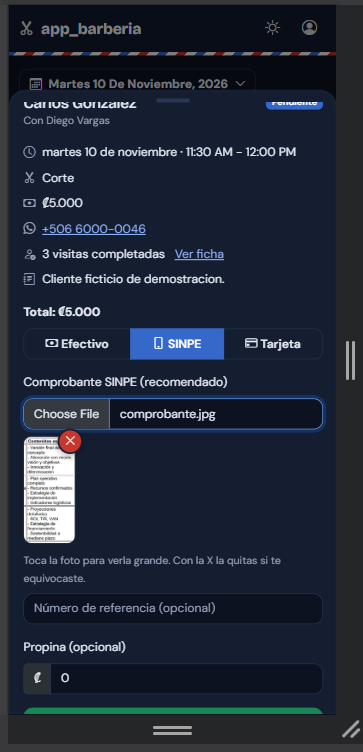
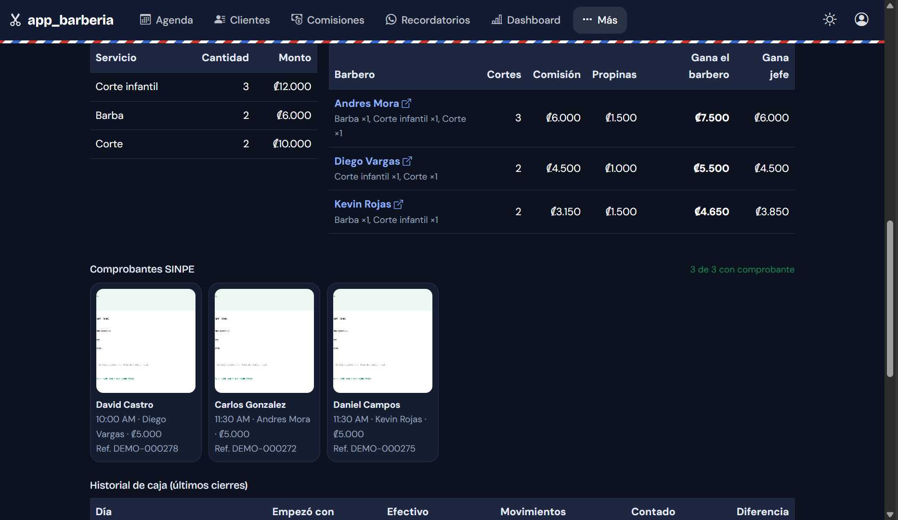
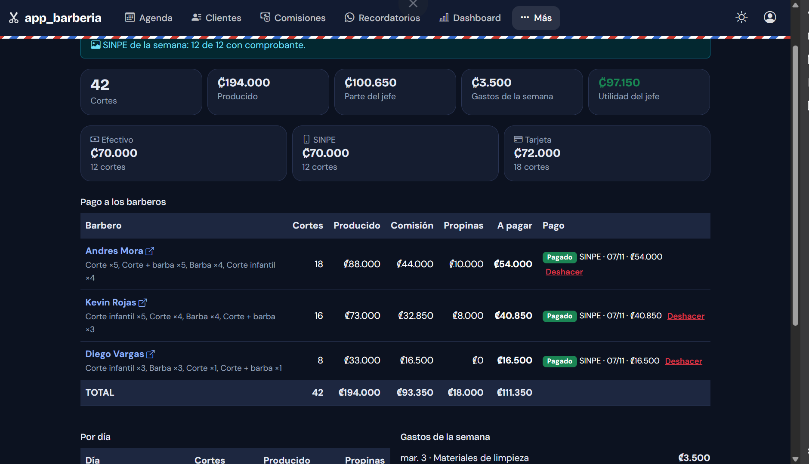
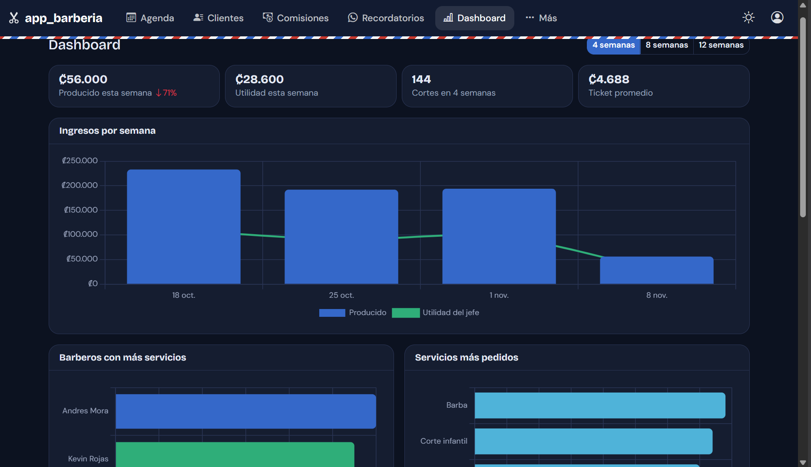
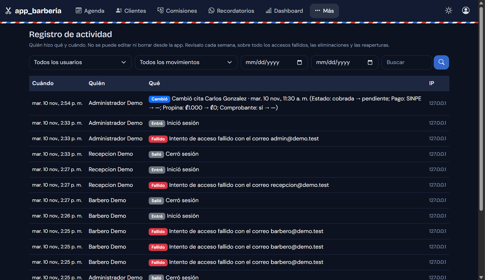

#  Agenda Barbería

Sistema web instalable (PWA) para administrar una barbería: agenda por barbero, clientes, cobros, comisiones semanales, cierre de caja y reportes.

Lo construí para usarlo en mi propia barbería, donde cada barbero trabaja por comisión, se cobra en colones (₡) y los pagos son en efectivo, tarjeta o SINPE Móvil.


> Las capturas usan **datos de prueba**. No hay clientes ni comprobantes reales.

<p align="center">
  
  
</p>
<p align="center">
  
  
</p>
<p align="center">
  
  
</p>
<p align="center">
  
  
</p>

##  Funciones

**Agenda**
- Columnas por barbero con línea de la hora actual; tocar un espacio libre abre la cita con barbero y hora ya puestos.
- Horarios libres calculados según la **duración de cada servicio**, sin choques con otras citas ni con bloqueos.
- Citas fuera del horario normal (6:00 AM a 11:00 PM), con el horario habitual resaltado.
- Calendario con selector de mes y año, con puntos en los días que tienen citas.
- Bloqueos de horario: almuerzo, día libre y vacaciones, por barbero o para toda la barbería.

**Clientes**
- Fichas con historial, visitas, servicio favorito, notas y teléfono único (formato de Costa Rica).
- Buscador en tiempo real por nombre o teléfono, también al agendar.
- Recordatorios por WhatsApp en lote, con marca de «enviado».

**Cobros y caja**
- Cobro por efectivo, SINPE o tarjeta, con propina.
- **Comprobantes SINPE** (foto o captura): se reducen en el celular, se guardan en privado y salen en el PDF del día.
- Cierre de caja diario con **caja acumulada**: lo contado hoy pasa como caja inicial de mañana.
- Gastos del local, retiros y aportes de caja.
- Reportes en **PDF** (día y semana, con columna de firma) y **Excel**.

**Equipo**
- Comisión por barbero, detalle de **qué servicios hizo cada día** y cuánto ganó.
- Cierre semanal (domingo a sábado, pago el sábado a las 7:00 PM) con pago registrado por efectivo o SINPE.
- Metas semanales con barra de progreso.
- Dashboard con gráficos: ingresos por semana, barberos y servicios más pedidos, horas y días más llenos.

**Seguridad y uso**
- Roles: **admin**, **barbero** (solo ve lo suyo) y **recepción** (sin acceso a dinero).
- Registro de actividad: quién cobró, canceló, eliminó o descargó qué, y cuándo.
- Recuperación de clave con enlace de un solo uso al correo registrado.
- Modo claro y oscuro. Funciona en PC y celular, y se instala como app.
- Respaldos automáticos y cifrados de la base de datos y las fotos.

##  Decisiones de diseño

| Tema | Decisión |
|---|---|
| **Precios y comisiones** | Cada cita guarda el precio y el porcentaje de comisión del momento. Si luego cambian, las semanas ya cerradas no se alteran. |
| **Semana de pago** | Domingo a sábado. El cierre semanal calcula comisión + propinas por barbero. |
| **Historial** | Barberos y servicios usan borrado suave: desaparecen de las listas, pero las citas viejas y los reportes se conservan. |
| **Caja** | `esperado = caja inicial + efectivo cobrado ± movimientos (gastos, pagos a barberos, retiros)`. La lógica vive en un servicio (`CashBook`) que comparten la pantalla y los PDF. |
| **Disponibilidad** | Se recorren los huecos libres de cada barbero y se generan horarios según la duración del servicio. Los bloqueos cuentan como tiempo ocupado. |
| **Validaciones** | Teléfono de 8 dígitos y único, sin choques por barbero ni por cliente, y mensajes de error en español. |
| **Comprobantes** | Se reducen en el navegador, se vuelven a codificar como JPG en el servidor (sin datos ocultos), se guardan fuera de `public` y se sirven con control de acceso por cita. |
| **Auditoría** | Un *trait* (`Audited`) registra los cambios de los modelos con el valor anterior y el nuevo. |

## Seguridad

Claves con hash, protección CSRF, permisos por rol validados en el servidor (no solo botones ocultos), bloqueo temporal tras intentos fallidos, desactivación inmediata de usuarios, cabeceras de seguridad, subida de archivos validada y reprocesada, enlaces de recuperación de un solo uso, y respaldos cifrados con AES-256.

## Tecnologías

Laravel · PHP · MySQL · Blade · Bootstrap 5 · JavaScript (módulos con Vite) · Chart.js · DomPDF · Service Worker / Web App Manifest.

## Estructura

```text
app/Http/Controllers/    Agenda, clientes, caja, semana, dashboard, comprobantes, actividad...
app/Http/Middleware/     Roles y cabeceras de seguridad
app/Models/              Modelos y el trait Audited (registro de actividad)
app/Services/            CashBook (caja), BarberBreakdown (comisiones), ProofStore (fotos)
config/barberia.php      Horario, reglas y plantilla de recordatorios
database/seeders/        Datos iniciales y DemoSeeder (datos de prueba)
resources/js/            Selector de horarios, avisos, confirmaciones y gráficos
resources/views/         Agenda, caja, semana, PDF, correos...
```

## Instalación (local)

Requisitos: PHP 8.2 o superior (con `gd`, `exif`, `zip` y `mbstring`), Composer, Node.js y MySQL o MariaDB.

```bash
git clone https://github.com/osvaldo-salazar/app_barberia
cd app_barberia
composer install
npm install
copy .env.example .env        # en Linux o Mac: cp .env.example .env
php artisan key:generate
```

Crea una base de datos vacía (por ejemplo `barberia`), configura `DB_*` en el `.env` y continúa:

```bash
php artisan migrate --seed
npm run build
php artisan serve
```

Antes de ejecutar `php artisan migrate --seed`, configura `ADMIN_NAME`, `ADMIN_EMAIL` y `ADMIN_PASSWORD` en tu archivo `.env`. Estas variables se utilizan para crear el usuario administrador inicial. Utiliza una contraseña segura y no publiques tu archivo `.env`.

## Probar con datos de prueba

Para ver la app llena, sin clientes reales, usa una base aparte.

1. Crea una base vacía llamada `barberia_demo`.
2. Copia tu `.env` como `.env.demo` y cambia estas líneas:

```env
DB_DATABASE=barberia_demo
SESSION_COOKIE=demo_session
```

3. Crea las tablas y carga los datos. El `--env=demo` es obligatorio:

```bash
php artisan migrate --env=demo
php artisan db:seed --class=DemoSeeder --env=demo
```

4. Inicia el servidor de prueba (PowerShell):

```powershell
$env:APP_ENV="demo"; php artisan serve --port=8001
```

Entra a `http://127.0.0.1:8001` con `admin@demo.test`, `barbero@demo.test` o `recepcion@demo.test`. La clave de los tres es `Demo12345`.

## Respaldos

```bash
php artisan barberia:respaldo
```

Genera un `.zip` con la base de datos y los comprobantes, cifrado con clave (AES-256), en la carpeta definida por `BACKUP_DIR`, y conserva los últimos 30. Se puede programar cada noche con el Programador de tareas de Windows.

## Próximos pasos

- [ ] Pruebas automáticas para comisiones y caja
- [ ] Lista de espera para horas ocupadas
- [ ] Paquetes y membresías de cortes
- [ ] Venta de productos con inventario
- [ ] Publicación en hosting con verificación en dos pasos

## Autor

**Osvaldo Daniel Salazar Oporta**: barbero y desarrollador de software · Costa Rica
[GitHub](https://github.com/osvaldo-salazar) · [LinkedIn](https://www.linkedin.com/in/osvaldo-salazar-517a87370/)

## Licencia

Código publicado como portafolio. Todos los derechos reservados.